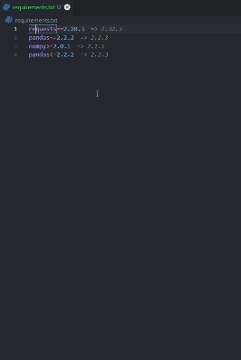

# Python Packages Handler

Python Packages Handler is a Visual Studio Code extension that helps you manage, update, and install Python package versions in your `requirements.txt` and `pyproject.toml` files.

## Features

- Update a single Python package to its latest version
- Update all Python packages in a `requirements.txt` or `pyproject.toml` file to their latest versions
- Update and install a single Python package
- Update and install all Python packages in a `requirements.txt` or `pyproject.toml` file
- Install packages without updating their versions
- Preserves existing version specifiers (e.g., `~=`, `>=`, `==`, `^`, etc.)
- Shows the latest available version for each package after the package line
- All commands available in a dedicated submenu for better organization
- `pyproject.toml` support covers:
  - PEP 621 `[project] dependencies` and `[project.optional-dependencies]` (including `dev`)
  - PEP 735 `[dependency-groups]`
  - Poetry `[tool.poetry.dependencies]`, `[tool.poetry.group.*.dependencies]`, and `[tool.poetry.dev-dependencies]`

## Installation

1. Open Visual Studio Code
2. Go to the Extensions view (Ctrl+Shift+X or Cmd+Shift+X on macOS)
3. Search for "Python Packages Handler"
4. Click Install

## Usage

### Video Tutorial

Here's a quick demonstration of how to use the Python Packages Handler extension:

### Viewing Latest Available Versions

1. Open a `requirements.txt` or `pyproject.toml` file in VS Code
2. The latest available version for each package will be displayed after the package line

### Using the Python Packages Menu

1. Open a `requirements.txt` or `pyproject.toml` file in VS Code
2. Right-click anywhere in the file
3. Navigate to the "Python Packages" submenu
4. Choose from the following options:

Update Options:
- Update Python Package Version
- Update All Python Packages

Install Options:
- Update and Install Python Package
- Update and Install All Python Packages
- Install Python Packages Without Updating

> Note: For `pyproject.toml`, the install commands run `pip install .` (or `pip install . --upgrade`) for the project, which resolves and installs the dependencies declared in the file.

## Requirements

- Visual Studio Code version 1.60.0 or higher
- Internet connection (to fetch latest package versions from PyPI)
- Python and pip installed on your system (for installation features)

## Extension Settings

This extension doesn't add any VS Code settings.

## Contributing

### Local extension development

Use Node.js/npm matching `package.json`, run `npm ci`, then `npm run compile`. Open this repository in VS Code and use the extension-development launch configuration to exercise commands. `npm test` uses the configured VS Code test runner; `npm run package` produces the production JavaScript build, not automatically a published marketplace release. These commands were not executed for this documentation refresh.

Package-version updates can introduce breaking changes even when a version-specifier operator is preserved. Review diffs and test the target Python project, use its intended virtual environment, and remember that installing a local `pyproject.toml` project can execute build hooks. Do not apply install commands to untrusted projects or commit private package-index credentials.

Contributions are welcome! Please feel free to submit a Pull Request.

## License

This extension is licensed under the [MIT License](LICENSE.md).

## Author

Created and maintained by Ahmad Einieh:
- [GitHub](https://github.com/ahmad-einieh)
- [Website](https://ahmadeinieh.online/)
- [LinkedIn](https://www.linkedin.com/in/ahmad-einieh/)
